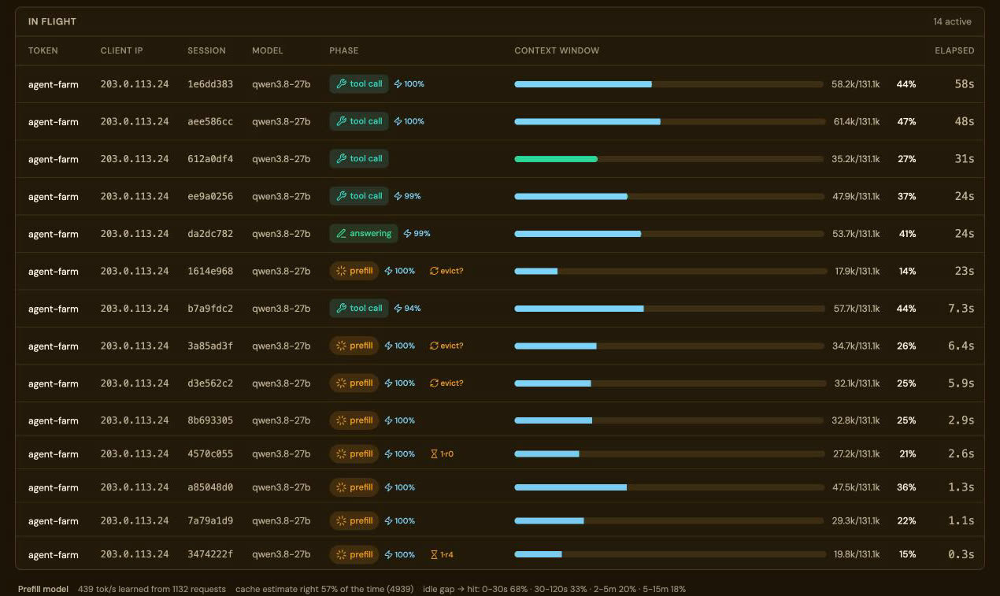
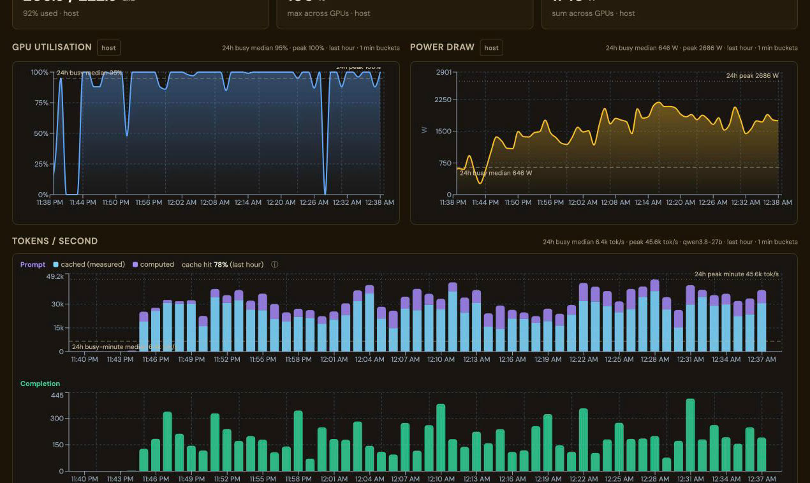

# Operating LM Warden day to day

Everything here is about the Linux install and assumes one that already
passes `make smoke`. The Mac app (beta) is run from its menu-bar menu instead;
its dashboard and API are the same, and
[MACOS-REMOTE-ACCESS.md](MACOS-REMOTE-ACCESS.md) covers reaching it from
another machine.
Getting there is [INSTALL.md](INSTALL.md); the things to read before the
first model is loaded are [HAZARDS.md](HAZARDS.md).

## Day-to-day

| Command | What it does |
|---|---|
| `make start` | start the stack (detached) |
| `make stop` | stop and remove the containers; volumes and data stay |
| `make restart` | stop + start, re-reading `.env` and the override |
| `make logs` | follow live logs (`make logs S=api` for one service) |
| `make status` | container state and health |
| `make smoke` | check the front door end to end (`/`, `/_landing`, `/ui/`, `/api/csrf`, `/healthz`) |
| `make pull` | pull the release named by `VERSION` in `.env` and restart on it |
| `make config` | print the fully merged compose config — what actually runs |
| `make preflight` | re-run the installer's host checks |
| `make save-images` / `make load-images` | move a release between hosts as a tarball |
| `make export-hf-cache` / `make import-hf-cache` | move the model cache the same way |
| `make uninstall` | stop and delete the data volumes (asks first) |
| `make help` | list every target |

**Upgrading:** set `VERSION` in `.env` to the new release (or
`./install.sh --version vX`) and `make pull`. When the stack files themselves
changed, `git pull && ./install.sh` refreshes `docker-compose.yml` and the
override and re-pins `VERSION`; `.env` is kept.

**Upgrading across the rename to `lm-warden`.** The product is now called
LM Warden (formerly LLM Warden and, before that, vLLM Warden). The repository
moved from `Podwarden/vllm-warden` (and briefly `Podwarden/llm-warden`) to
`Podwarden/lm-warden`, and the images from
`registry.podwarden.com/podwarden/apps/vllm-warden{,-ui}` (and briefly
`.../llm-warden{,-ui}`) to `.../lm-warden{,-ui}`. Nothing an install stores
was renamed: the volumes, container names and the `/data/vllm-warden.db`
database keep their `vllm-warden` names, so an existing install upgrades in
place.

- Every release is still published under both old image names as well (same
  digest) until **2026-12-31**, so an install that keeps pulling
  `.../vllm-warden:${VERSION:-latest}` or `.../llm-warden:${VERSION:-latest}`
  keeps getting updates until then. Re-run
  `./install.sh` from an updated checkout at your leisure before that date: it
  rewrites `docker-compose.override.yml` to the new image names and keeps `.env`.
- `git pull` keeps working (GitHub redirects the old URL); point the remote at
  the new one when convenient:
  `git remote set-url origin https://github.com/Podwarden/lm-warden.git`.
- **Keep your existing checkout directory.** The volumes belong to the Compose
  project name. `install.sh` writes `COMPOSE_PROJECT_NAME=vllm-warden` into
  `.env`, which pins the names (`vllm-warden_vw-data`, `vllm-warden_vw-hfcache`,
  `vllm-warden_caddy-*`) whatever the directory is called. Without that line --
  an `.env` written by hand, or plain `docker compose up` in a checkout with no
  `.env` -- Compose names the project after the directory, and a fresh
  `git clone` now lands in `lm-warden/`: that stack would start on new, empty
  volumes. Check with `docker compose config | head -1` (it prints
  `name: vllm-warden`), and if it does not, add `COMPOSE_PROJECT_NAME=vllm-warden`
  to `.env` before the first `make start`.

Once running:

- **UI** — `http://YOUR-HOST:8080/ui/`
- **OpenAI API** — `http://YOUR-HOST:8080/v1/chat/completions`
- **Control API** — `http://YOUR-HOST:8080/api/` (JWT-gated)
- **Health** — `http://YOUR-HOST:8080/healthz` (liveness, always `200` while up)
- **Ready** — `http://YOUR-HOST:8080/readyz` (`200` once a model can serve, `503` before)

For gated models (Llama, Mistral, gpt-oss) you need a HuggingFace token. The
first-run wizard asks for one, and you can change it later under
**Settings → General**.

**On HTTP vs HTTPS.** Plain `http://` works — the session cookies follow the
scheme the browser actually used, so a LAN install stays signed in. It is still
an evaluation posture: the API key and the session both cross the network in the
clear. For anything shared, terminate TLS in front of the `:8080` listener and
tell the warden its public URL with
`./install.sh --origin https://llm.example.com`; the cookies then carry
`Secure`. If your proxy sets `X-Forwarded-Proto`, set `VW_TRUST_PROXY_ORIGIN=1`
in `.env` so the warden believes it.

**The Mac app (beta).** It also speaks plain HTTP, and listens on
this Mac only until you turn on **Share on Local Network**.
[MACOS-REMOTE-ACCESS.md](MACOS-REMOTE-ACCESS.md) covers what it listens on, what
sharing changes, and putting Caddy or Tailscale HTTPS in front of it.

**The page at `/`.** **Settings → Networking → Home page** decides what the
address of the warden shows. **Built-in** (where a new install starts) is a
short welcome page that links to the console: no scripts, nothing loaded from
elsewhere, marked `noindex`. **Off** shows no page, and `/` answers with the
option below it: open the console (a redirect to `/ui/`) or a plain 404.
Existing installs keep what they showed before. `robots.txt` disallows
everything either way, and `/agent-guide.md` is served regardless.

LM Warden's own product website (home, coding agents, FAQ, the Mac download
link, `llms.txt`) is not part of the app: it lives at
[lmwarden.com](https://lmwarden.com). An install that used to have
**Public website** switched on now shows the built-in welcome page, and the
website's paths answer 404.

---

## Managing API keys

**API tokens** lists every key; click a name — there or on the stats page —
to open that key's page at `/ui/tokens/{id}`. Everything you can do to a key
is on it:

- **Rename** it with the pencil next to the name (Enter saves, Esc cancels).
  Names need not be unique.
- **Pause** it. A paused key's next request gets
  `403 {"detail":"token paused"}`, so a client can tell "switched off" from
  "wrong key" (401).
  Requests already running finish and nothing queued is aborted. **Resume**
  lets the next request through. An expired key, or one revoked past its
  grace window, cannot be paused — it is already refused. An old key still in
  its rotation grace window can be, which cuts it off early.
- **Priority**, P0 to P9. Scheduling is strict: a waiting P9 request always
  goes before a P8 one, so a low priority can wait indefinitely on a busy box.
  If you want fair sharing, give every key the same priority. Priority is the
  only per-key fairness control: per-key rate limits were removed in
  v2026.09.18.2, because they counted prompt tokens only. An API body that
  still sends `rate_limit_tps` is refused with 422, and
  `VW_RATE_LIMIT_WINDOW_S` is no longer read — a leftover line in `.env` is
  ignored.
- **Test** it: whether the key is live, paused, expired or revoked, and
  whether the proxy answers.
- **Rotate** it. A new key keeps the name; the old one becomes
  `<name> (old N)` and keeps working through a grace window you choose
  (24 hours by default). The page then moves to the new key.
- **Delete** it.
- **Rotation history** lists the keys this one replaced, oldest first, each
  linking to its own page with when it was rotated and whether its grace
  window is still open.

**Usage.** The charts show tokens per minute (prompt or completion), requests
per minute, queue wait, and latency (first token or full response) — median
solid, 95th percentile dashed — over 1h, 6h, 24h or 7d, or a custom period:
drag the window on the history strip, which covers the key's whole life with
each rotation marked, or type **From** and **To** and press **Apply**. The
period is kept in the URL, so a reload or a shared link shows the same view.
**Include earlier keys** (on by default) adds the keys this one was rotated
from. Bins are chosen on the server, at most about 360 per chart, and a
minute with no traffic counts as zero rather than being skipped. Presets
refresh on their own; a custom period does not.

Queue wait and latency come from per-request timings, which are recorded per
key from v2026.09.18.1 on and kept as long as the rest of request history —
30 days by default (`VW_REQUEST_HISTORY_RETENTION_DAYS`). A period before that is
hatched and labelled "Not recorded", so it does not read as idle. On a very
busy key the timings are computed from an even sample of its requests, and
the chart says so; request and token counts are always exact.

The same actions and series are in the API — see
[Managing a key from the API](API.md#managing-a-key-from-the-api).

---

## The Stats page

The Stats page shows one model at a time. Pick it in the scope bar under the
title: one tab per loaded model, each with its state (Idle, Busy, or Queueing
when the warden's admission queue or the engine's own queue holds requests).
On a box with one model the tab is not clickable. Every panel from Now down to
Engine details shows exactly that model, and says so in its header. Latency,
speed and cache are never averaged across different models. The window (1h,
6h, 24h, 7d) is on the right of the title.

Panels keep their size. Every panel above the Requests block has a fixed width
and height, whether the model is idle, busy, has no data or only a handful of
requests, so the page does not jump while you read it. Problems (a failed
metrics scrape, lost GPU telemetry, an engine without metrics, dropped stats
writes) appear on one reserved line under the scope bar, not as banners that
push the page down.

Top to bottom:

| Panel | What it shows |
|---|---|
| **Now** | Generation and prefill speed right now, smoothed over 10 s on the server. Prefill counts computed tokens only: prompt tokens served from the prefix cache are not compute and do not inflate it. Running, engine waiting and warden queue counts, KV cache in use, and a 5-minute chart that starts full when you open the page (the server keeps the last 5 minutes while anyone watches). When nothing runs it says "idle, last request N min ago", never "0 tok/s". |
| **Latency and speed** | Four tiles over the window: time to first token (including the time spent in the warden's queue), decode speed per request, prefill speed per request (computed tokens only, requests that prefilled alone with at least 512 new tokens), and duration. Each shows the median large, the 95th percentile small and the number of requests. With fewer than 5 requests the tiles list the values instead; from 5 to 19 they show the median and the maximum. Below them, one chart with a dot per request, switchable between TTFT, decode and prefill, by time or by prompt size, with a rolling median of the last 20. |
| **Tokens / second** | Prompt tokens (cached and computed) and completion tokens per minute. Tokens are booked to the minutes they were produced: the prompt to the minute of the first token, the reply spread from the first token to the finish. A long generation no longer shows as one spike in the minute it ended. A request that is not streamed has no first token the warden can see, so its prompt books at the minute it started and its reply is spread over its whole run. The last few minutes can still grow until long requests finish. Minutes recorded before this change keep their old booking: they are not rebuilt. |
| **Cache** | One cache-hit figure: engine-measured cached tokens divided by the prompts of those same requests, with how many requests were measured, the cached against computed bar, the outcome bar, prefill time saved and efficiency. |
| **Host** and **System configuration** | VRAM, GPU utilisation and power for the whole host, their charts, and the hardware. These are host-wide: two models on the same cards cannot be told apart. |
| **Engine details** | Counters since the engine started: prompt and generated tokens, stop, length and abort counts, the engine's own block-level prefix cache hit rate, and preemptions (a lifetime count; the old per-second rate read 0.00 almost always and is gone). |
| **Requests chart** | Every finished request of the model in the window: finish time across, duration up (log scale), coloured by key, sized by generated tokens, shaped by finish reason. |
| **Requests** table | See below. |

### The Requests table

The table at the bottom is the only list of requests on the page and the only
place for breakdowns. It shows every request by default, all models, not only
the scope. It is a fixed 8 rows high (6 on a phone): fewer rows leave faint
placeholder rows, more rows scroll inside the box.

- **Group by** key, client IP, or model (when more than one is loaded). Grouped
  rows put live figures (in flight, the summed live decode speed) next to window
  figures (requests, prompt tokens, median TTFT, decode and prefill speed). A key
  that used two models gets one row per model, so speeds are never mixed.
- **Rows**: Everything or Scope only, when more than one model is loaded.
- **Show**: in flight only, or also requests that finished in the last minute.
- **Pause order** freezes the row order while the values keep updating.

**Out** and **tok/s** count real tokens of every kind the model generates,
thinking and tool calls included, and tok/s is the request's own decode speed
over the last 5 seconds. **TTFT** includes the warden queue; hover it for the
split.

Removed from the old page: the model checkboxes (one scope instead), Token
throughput (the Tokens / second chart and the speed tiles cover it), the
Preemptions panel, the three latency histograms, the By token, By client IP
and Tokens per API key tables (Group by in the Requests table), and the extra
"from cache" figure on the tokens chart.

Several installs combined into one cluster are not shown together yet. When
that arrives, the scope bar will also choose installs.

---

## Reading what is in flight

**The Requests table** at the bottom of the Stats page has one row per request the warden
is serving, refreshed every 1.5 s. Finished rows fold away and new ones open in
(no animation under reduced motion), so the rows you are watching stay put.
Below 768 px wide the table becomes a list of two-line cards.

*A seven-GPU box serving a farm of Claude Code agents, 5 October 2026. The key
name is a stand-in and the client address a documentation address.*

**Session** is the conversation the request belongs to (the first 8 characters
of its id; the tooltip says which signal it came from). A dimmed dash means the
client sent no id and the conversation was inferred from its first message.
See [Which conversation a request belongs to](#which-conversation-a-request-belongs-to).

**Phase** is where the request is in its life:

| Pill | Meaning |
|---|---|
| `queued 2.1s` | waiting at the warden's admission gate, before it reaches the engine |
| `prefill` | the engine is reading the prompt; nothing has streamed back yet |
| `thinking` | the model is streaming reasoning |
| `tool call` | the model is writing a tool call |
| `answering` | the model is streaming its answer |
| `waiting` | a non-streamed request: the engine says nothing until the reply is complete, so it is never flagged slow |

Badges after the pill:

- **⚡ 96%** — the share of this prompt estimated to be in the replica's prefix
  cache, shown from 50 % up. It is an estimate: the engine reports the real
  figure only when a request ends, so it is worked out from the same
  conversation's previous request on the same replica. When the warden has
  learned that sessions idle this long usually lose their cache, the estimate
  is scaled down and shown dimmed.
- **⌛ 1·r4** — this prefill is queued behind 1 earlier prompt still prefilling
  on replica 4 (for a model with one replica, behind prompts on that model).
- **evict?** — no token yet although most of the prompt was expected to be
  cached, and nothing is ahead of it: the cache was probably evicted.
- **slow** (a turtle) — still prefilling well past the expected time,
  `max(3 s, 4 × uncached tokens / prefill rate)`, for no reason the warden can
  see. The warden cannot see the engine's own queue.

Every pill and badge has a full-sentence tooltip. The context bar draws the
estimated cached part of the prompt in blue at its start.

**The prefill model** line under the table is what the warden has learned
about this box from the last 24 hours of finished requests, about once a
minute and off the request path: the prefill rate (the median over requests
that prefilled alone, with at least 512 uncached tokens; until 20 such requests
exist, `VW_PREFILL_TOK_S_HINT`, default 2000 tok/s, is used instead), how often
the cache estimate was right (measured at least 0.8 of the estimate), and how
the hit rate falls with the time a session sat idle (0-30 s, 30-120 s, 2-5 min,
5-15 min). `GET /api/stats/v2/prefill-model` returns the same.

**Measured cache hits.** vLLM is started with `--enable-prompt-tokens-details`
(unless `extra_args` already sets it or turns it off, or the model pins a vLLM
older than 0.7, which lacks the flag), and llama.cpp reports its own cache timings, so each finished
request records how many of its prompt tokens came from the cache, next to the
estimate. The **Tokens / second** chart stacks prompt tokens into cached
(measured, blue) and computed (purple) and prints the cache-hit share for the
last hour. A request the engine did not measure counts as computed, so the
share is never overstated; the tooltip says how many of a minute's requests
were measured. Tokens are booked to the minutes they were produced (see
[The Stats page](#the-stats-page)).

### Which conversation a request belongs to

The Session column and a data-parallel model's replica routing read the same
signal, so they never disagree. The first of these that is present and looks
like an opaque id (8 to 128 characters of `A-Z a-z 0-9 _ . : -`, no spaces,
no `@`) wins; anything else is ignored and the next is tried:

1. `X-Claude-Code-Session-Id` (Claude Code)
2. the session inside `metadata.user_id` (Claude Code)
3. `X-Session-Id` (OpenCode, Hermes, Aider when configured)
4. `x-session-affinity` (OpenCode sends it too; pi)
5. the `session_id` (pi) and `session-id` (Codex) headers
6. the body's `prompt_cache_key` (Codex, and pi on the Responses API)
7. an id-shaped body `user`
8. `x-client-request-id`, as a last resort (pi and Codex set it to the session id)

With none of them, the conversation is a hash of its first real user message
(with the key), shown as a dimmed dash. Known harness preambles are skipped
first (Aider's example conversation and repo map, Codex's
`<environment_context>`), so two chats from one tool are not taken for one. A
value that embeds a Claude Code account id is reduced to its session part and
never shown. For a subagent the tooltip also names the parent session
(`x-parent-session-id`, `x-codex-parent-thread-id`).

Per client:

- **Claude Code**, **OpenCode** and **Codex CLI** send an id by themselves:
  nothing to do.
- **Hermes**: add `session_affinity_header: X-Session-Id` to the provider entry.
- **pi**: set `"compat": {"sendSessionAffinityHeaders": true}` in `models.json`.
- **Aider** has no session header of its own. The **Connect** page has a
  wrapper that writes `.aider.model.settings.yml` with
  `extra_params.extra_headers.X-Session-Id` set to a fresh uuid on every launch;
  run it instead of `aider`.

**Connect** (`/connect`) writes the setup for each of these clients with this
warden's address, a key and a loaded model, checks the requirements it can see,
and sends a test request. Its data is `GET /api/connect/clients`
([Connect a client](API.md#connect-a-client)).

---

## Where request content can end up

By default no prompt or completion text is stored anywhere. `request_history`
— the table behind the requests chart and the per-key rollups — has no column
that holds it; it carries identifiers, token counts, timings and finish
reasons, and that is the whole of the metadata path. Two diagnostic features
can capture content. Both are off by default, and with both off the proxy's
forward path is the code it would be in a build that never had them.

**Prompt Lens** (called god mode before 2026-11-22; turned on by the switch in
Settings, General, Privacy, or `VW_PROMPT_LENS_ENABLED`) streams prompts,
replies, reasoning, tool calls and any inline images to the admin session —
the way to settle "the model said X" when the client is somebody else's code,
and to see which parts of a prompt matched earlier requests. Its name on
screen changed from "God mode" to "Prompt Lens" on 2026-11-22, and its other
names followed: the env variables are `VW_PROMPT_LENS_*` and the routes
`/api/{admin,me}/prompt-lens/...`; the old `VW_GODMODE_*` names and `/godmode`
routes still work for one release (deprecated). The Settings switch overrides
the env variable and applies at once: off ends every open Prompt Lens view and
clears what memory holds (kept captures stay on disk). With it on, Prompt Lens
is a page of its own, in the menu: `/ui/prompt-lens` for the admin (every key;
breadcrumb Home › Prompt Lens) and `/ui/key/prompt-lens` for a key holder
(their own requests only; in the key area's nav). It takes the whole screen:
the filter line at the top, the list of requests, live and recent, beside the
request screen, which opens one: its prompt part by part (the kvsig prompt
map), thinking, reply and tool calls as they stream. On a phone the list fills
the screen and a request replaces it ("‹ Requests", or the back gesture, goes
back). Opening the page replays what is still in memory and then streams new
requests live; leaving it closes the stream. With the flag off the menu entry
is not shown and the page says Prompt Lens is off (for a key holder: not
available).

Ways in: the eye on a Requests row of `/stats` or `/key/stats` (and a dot of
the key holder's requests chart) opens the page on that request
(`?req=<request id>`); "Open this key's requests in Prompt Lens" on a key's
page opens it with that key and the keys it was rotated from in the Key filter
(`?key=<id>,<id>`), also while Prompt Lens is off if the key keeps captures.
Picking a request writes `?req=` into the address, so the link can be shared
and a reload opens the same request. Until 2026-11-23 Prompt Lens was a dock
along the bottom of those three pages; the dock had no address of its own, so
there are no old links to redirect, and the filters it saved in the browser
carry over to the page.

The page decides only what you watch, not what is captured: while the flag is
on, every key's traffic goes into memory whether or not the page is open. What
it keeps:

- A replay ring of 2000 events and ~4 million characters by default
  (`VW_PROMPT_LENS_RING_EVENTS`, `VW_PROMPT_LENS_RING_CHARS`), oldest evicted first,
  with inline images in a separate bounded store beside it. Each key also has
  a replay window of its own (500 events, 400,000 characters, 64 request
  starts, dropped after 30 idle minutes; at most 128 windows, about 51
  million characters in all) so what a key holder replays depends only on
  their own traffic. Outside that budget, each window also remembers up to 32
  of its key's running requests and their prompt maps (kvsig, at most 64
  parts each), so a page that opens mid-request gets their starts back: tens
  of MB at worst, with 128 keys each running 32 long requests at once.
- A whole-section store that keeps each request's thinking, reply, tool calls
  and a wider prompt capture so a section can be opened whole. Four variables
  bound it: `VW_PROMPT_LENS_SECTION_MAX_CHARS` (2,000,000) characters per channel,
  oldest dropped first; `VW_PROMPT_LENS_SECTION_CHARS` (16,000,000) in all, and
  512 requests; `VW_PROMPT_LENS_SECTION_TTL_S` (600) seconds kept after a request
  ends; `VW_PROMPT_LENS_SECTION_PROMPT_CHARS` (256,000) for the wider prompt
  capture and for one request's tool calls. Each key has its own share (a
  quarter of the characters, 64 requests), so a quiet key keeps its sections
  while a busy one streams.
- A prompt longer than `VW_PROMPT_LENS_MAX_PROMPT_CHARS` (16000) is captured on
  the stream as its head plus a `VW_PROMPT_LENS_PROMPT_TAIL_CHARS` tail, so the
  newest turn survives a large repeated system prompt — display-only, and
  never a change to what is forwarded.

Nothing reaches the database or the disk, and all of it is gone when the
container restarts — with one exception an admin opts into per key: **keep
captures** (the switch on the key's page). With it on, the key's last 50
finished requests, prompts included and at most 32,000,000 characters in all,
are written to the database (`prompt_lens_kept`), oldest dropped first, so they
outlive memory and a restart. Turning it off deletes them, for the key and the
keys it was rotated from; deleting the key deletes them. The key holder's
capture note then says the last 50 are kept on disk for this key, and they
see them only as they see their own live requests.

The bearer token never reaches the viewer; only the key's name does. While
the flag is on, that text sits in the api container's memory and any holder
of the admin session can read it: there is no separate role that cannot,
because the project has no roles. A key holder sees their own key's requests
only: no client IP, no key label, no figure about other keys' cache use, and a
prompt part another key made cached reads "new" for them.

What it does not show, or cannot hide:

- Requests relayed to Anthropic by the router do not appear in Prompt Lens
  yet. A request the sensitive data guard blocks is in the guard log, not in
  Prompt Lens.
- The reply is shown as plain text: no markdown rendering yet.
- kvsig part labels say "loose" for a loose-only match, without a profile
  name: LM Warden's loose form is its own, not the kvsig loose/1 profile.
- A request already running when the page opens shows its prompt, model and
  session: the server sends its start again ("restored") when a long stream
  pushed it out of the replay. A start is lost only if the key's own later
  requests pushed it out of the key's memory budget.
- Timings (`phase`, `queued_s`, `ttft_s`) rise when the server is busy with
  other keys' work: they show load, not who caused it. The API's own
  `usage.cached_tokens` reflects the engine's shared prefix cache, so another
  key's recent prompt can raise it; isolated keys (KV-cache tiers) are the
  answer where that matters. With more than 128 keys active, the least
  recently active key's replay window goes first, and the key with the most
  section text kept can lose its oldest section to the others' combined
  traffic.

Details, events and routes: [API.md, Prompt Lens](API.md#prompt-lens-Prompt Lens).

**The content log** (`VW_CONTENT_LOG_ENABLED`) is the one that writes to disk.
Each logged request appends a JSON line — prompt, completion, token counts,
finish reason — to `VW_CONTENT_LOG_PATH`, which defaults to
`/data/logs/content.jsonl`. That is the persistent data volume, the same one
that holds the SQLite database, so the file is inside whatever backs that
volume up. It is scoped as well as gated: a request is logged only when the
flag is on **and** its token id appears in `VW_CONTENT_LOG_TOKENS`, an
explicit comma-separated allowlist that is empty by default. There is no "log
everything" mode. `VW_CONTENT_LOG_MAX_CHARS` (40000) caps the prompt and the
completion within each record.

Three properties of that file to know before enabling it:

- **It has a size ceiling, not rotation.** `VW_CONTENT_LOG_MAX_CHARS` bounds
  each record, not the file; `VW_CONTENT_LOG_MAX_BYTES` (512 MiB) bounds the
  file. On reaching it the writer stops and logs one warning naming the file
  and the limit — deliberately, so the incidents the log was armed to capture
  are not deleted to make room for newer ones. Nothing prunes, truncates or
  rotates it; archive or remove the file, or turn the flag off, to resume.
  `0` or a negative value switches the ceiling off, the same convention
  `VW_ENGINE_LOG_MAX_BYTES` uses.
- **It shares a volume with the database.** The ceiling exists because
  letting it grow until that volume is full is an outage, not merely a large
  file.
- **It is created owner-only.** The `logs` directory is created `0700` and
  the file `0600`, both applied at creation rather than left to the process
  umask. An existing file keeps whatever mode it has — the product never
  `chmod`s it — so a content log written by a build before v2026.09.07.1 keeps
  its old, umask-derived mode until you `chmod 600` it once.

Retention past the ceiling, and shipping the file anywhere, are yours to
arrange.

`VW_RUNAWAY_MODE=log` has no sink of its own. It attaches its trip signal to a
record the content log was already going to write, so it captures nothing
unless content logging is enabled *and* the request's token is on that
allowlist.

`VW_PROMPT_LENS_ENABLED` and all five content-log variables are in `.env.example`,
each with what its default does; set them in `.env`, or in the environment of
whatever runs the api container.
